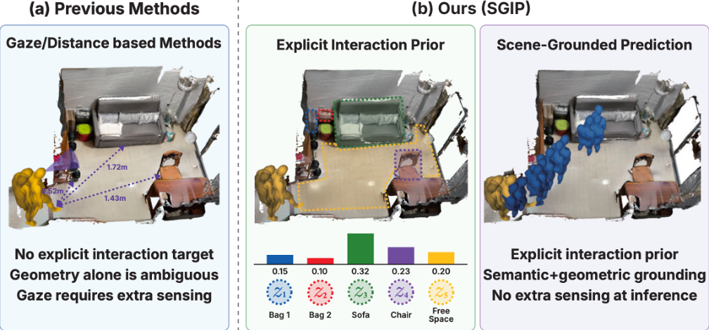

# SGIP

Teacher–student human motion forecasting.

Research code prepared for the NeurIPS 2026 paper release. This repository
contains motion forecasting, object selection, distillation, preprocessing,
and evaluation code from the research workspace.



**Overview.** SGIP uses an explicit interaction prior to guide scene-grounded
human motion prediction, combining semantic and geometric cues without extra
sensing at inference.

**This is a source-only release. No checkpoints or pretrained weights are
included**, including VPoser. Datasets, cached tensors, selector outputs,
training logs, and experiment results are also excluded. Training still writes
checkpoints locally; `.gitignore` keeps them out of Git.

## Code map

| Path | Purpose |
| --- | --- |
| `train_dual.py`, `eval_dual.py` | Main GIMO motion training and evaluation |
| `config/` | Command-line configuration for GIMO, HIK, and HOI-M3 |
| `model/sif3d_final.py` | GIMO SIF3D model with object-conditioned attention |
| `dataset/` | Dataset loaders and object-point cache exporters |
| `object_selector/` | Scene graphs, teacher targets, same-space selector |
| `object_selector_new/` | Teacher scoring, student selector, residual reranking |
| `train_hik*_1s2s.py`, `train_hoim3_direct24_1s2s.py` | Additional dataset protocols |
| `scripts/` | Training launchers, preprocessing, ablations, visualization |
| `utils/`, `tests/` | Losses, metrics, logging, and existing unit tests |

Historical `*_old*`, `*_kd_*`, and experiment scripts retain their filenames
and imports. Their presence does not identify a paper's final configuration.
See [experiment notes](docs/experiments.md) before choosing an ablation.

## Environment

Use Python 3.10 or newer in a dedicated environment. The original training
environment lock was not present in the workspace, so the requirements files
list direct dependencies rather than claiming an exact reproducibility lock.

1. Install PyTorch compatible with your machine and the PointNet2 extension.
2. Install the core Python dependencies:

   ```bash
   python -m pip install -r requirements.txt
   ```

3. Install both `pointnet2_ops` and the `pointnet2` Python package from
   [Pointnet2_PyTorch](https://github.com/erikwijmans/Pointnet2_PyTorch), following
   its build instructions. The model imports both packages. Its custom
   operations require CUDA; the full model is not a CPU-only pipeline.
4. Install a version of
   [human_body_prior](https://github.com/nghorbani/human_body_prior)
   that provides `human_body_prior.tools.model_loader.load_vposer` and supports
   VPoser v1.0 snapshots. Obtain VPoser v1.0 and the neutral SMPL-X model from
   the [SMPL-X project](https://smpl-x.is.tue.mpg.de/).
5. For selector backends or visualization, install the packages you need from
   `requirements-optional.txt`. Local transformer backends and remote Ollama
   backends have different requirements.

The PointNet2 and VPoser dependencies use older interfaces. A fresh install of
every package's latest release has not been validated. See
[data and model preparation](docs/data.md) for required external assets.

## GIMO training

Run commands from the repository root. Put prepared GIMO caches under
`data/GIMO`, SMPL-X under `data/body_models`, and the complete VPoser v1.0
snapshot under `vposer_v1_0`, or set the paths explicitly:

```bash
export DATAROOT=/path/to/GIMO
export SMPLX_PATH=/path/to/body_models
export VPOSER_PATH=/path/to/vposer_v1_0

bash scripts/run_teacher_train.sh
```

The launcher accepts `CUDA_VISIBLE_DEVICES`, `PYTHON_BIN`, `OBJECT_POINTS_NAME`,
`SAVE_PATH`, `BATCH_SIZE`, `LR`, and `SEED`. Additional arguments are forwarded:

```bash
bash scripts/run_teacher_train.sh --epoch 100 --compact_checkpoints
```

Equivalently:

```bash
python train_dual.py \
  --dataroot "$DATAROOT" \
  --smplx_path "$SMPLX_PATH" \
  --vposer_path "$VPOSER_PATH" \
  --object_points_name final_object_qwen3_14b_motion_c_final_points_1024.pth \
  --save_path runs/teacher --seed 7
```

## Evaluation

Train a model first or provide your own compatible checkpoint:

```bash
python eval_dual.py \
  --dataroot "$DATAROOT" \
  --smplx_path "$SMPLX_PATH" \
  --vposer_path "$VPOSER_PATH" \
  --load_model_dir runs/teacher/best_loss_trans.pth
```

To evaluate all `best_*.pth` files in a run directory:

```bash
RUN_DIR=runs/teacher bash scripts/run_teacher_eval.sh
```

Use the same model variant, object cache, sequence lengths, and preprocessing
as training. No reported accuracy is asserted by this packaging step.

## Object selection and distillation

See [scene-graph preparation](object_selector/README.md) and
[selector training](object_selector_new/README.md). Scene graphs, sample JSONL,
teacher CSVs, and object-point tensors must be generated or supplied locally.

Motion distillation additionally requires a locally trained teacher checkpoint
and matching teacher/student object caches. The multi-seed research launcher
is retained in `scripts/launch_ours_student_train_dual_old_0351_kd_third1423_multi_seed_gpu0.sh`;
set `TEACHER_CHECKPOINT` before running it.

## Checks

```bash
python -m pip install -r requirements-dev.txt
python -m pytest -q
python scripts/check_release.py
```

The tests check losses, metrics, and a mocked Ollama request. They do not train
the model or reproduce paper results. The release check inspects the Git index
for weights, generated artifacts, oversized files, and common secret patterns.

See [release notes](docs/release.md) for packaging scope and validation limits,
and [third-party notices](THIRD_PARTY_NOTICES.md) for dependency attribution.
